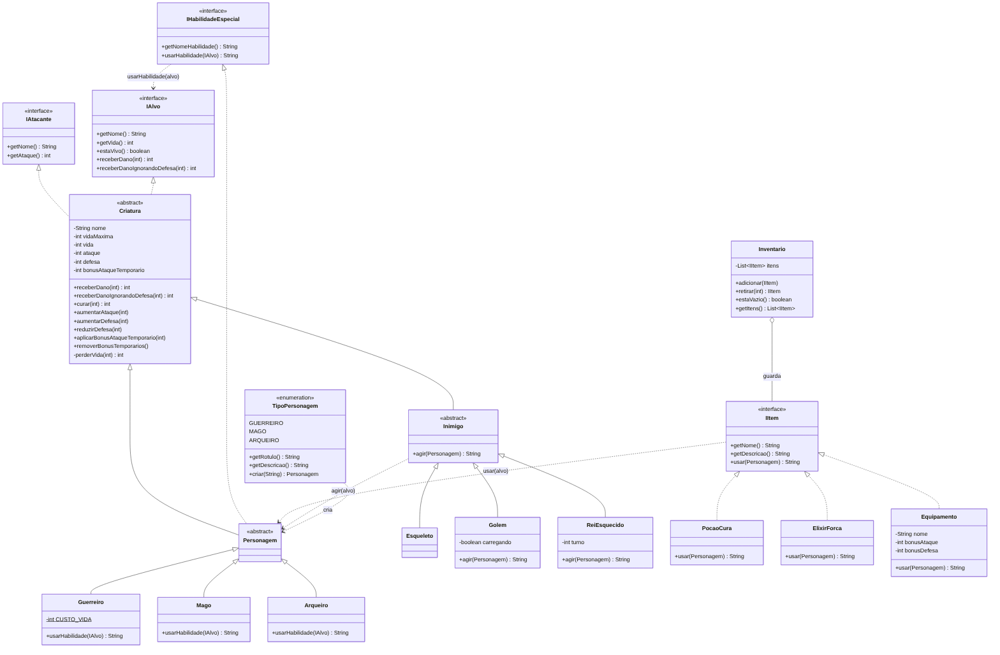
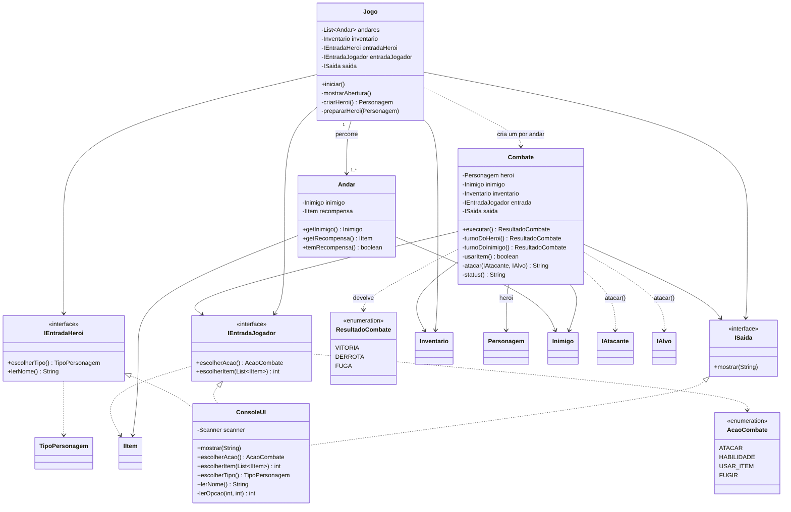

# A Torre do Rei Esquecido

RPG de console em Java, desenvolvido como trabalho prático de **Paradigmas de Programação** (Programação Orientada a Objetos e princípios SOLID).

**Autora:** Sarah Ivini

**Turma:** CCN2B

---

## Sumário

1. [A história](#1-a-história)
2. [O jogo](#2-o-jogo)
3. [Como compilar e executar](#3-como-compilar-e-executar)
4. [Estrutura do repositório](#4-estrutura-do-repositório)
5. [Diagrama de classes](#5-diagrama-de-classes)
6. [Orientação a Objetos no projeto](#6-orientação-a-objetos-no-projeto)
7. [Princípios SOLID: onde e como foram aplicados](#7-princípios-solid-onde-e-como-foram-aplicados)
8. [Capturas de tela](#8-capturas-de-tela)
9. [Decisões de projeto e limitações](#9-decisões-de-projeto-e-limitações)
10. [Uso de ferramentas de IA](#10-uso-de-ferramentas-de-ia)

---

## 1. A história

O reino de Eldoria está coberto por uma névoa sombria que vem da Torre do Rei Esquecido. Um herói sobe a torre, andar por andar, enfrentando criaturas corrompidas até chegar ao chefe final, o próprio Rei Esquecido, para quebrar a maldição.

## 2. O jogo

A torre tem **3 andares**, cada um com um inimigo. O último andar é o chefe. Antes de cada andar, o jogador pode usar itens do inventário. Ao vencer um andar (exceto o do chefe), o herói ganha um item.

### Personagens jogáveis

O jogador escolhe a classe e o nome do herói no início da partida.

| Classe | Vida | Ataque | Defesa | Habilidade especial |
|---|---|---|---|---|
| Guerreiro | 120 | 20 | 10 | **Golpe Poderoso**: dano dobrado, custa 10 de vida |
| Mago | 70 | 30 | 3 | **Bola de Fogo**: dano que ignora a defesa do alvo |
| Arqueiro | 90 | 22 | 6 | **Tiro Duplo**: dois ataques seguidos |

### Inimigos

| Andar | Inimigo | Vida | Ataque | Defesa | Comportamento |
|---|---|---|---|---|---|
| 1 | Esqueleto Soldado | 40 | 12 | 2 | Fraco, ataque simples |
| 2 | Golem de Pedra | 80 | 24 | 8 | Muita defesa; ataque lento (num turno ergue os punhos, no seguinte ataca) |
| 3 (chefe) | Rei Esquecido | 120 | 20 | 6 | Ataque normal e, a cada 3 turnos, lança a **Maldição**, que reduz a defesa do herói em 3 |

### Itens

| Item | Tipo | Efeito |
|---|---|---|
| Poção de Cura | Consumível | Recupera 40 de vida (sem passar da vida máxima) |
| Elixir de Força | Consumível | +10 de ataque até o fim do combate atual |
| Espada de Ferro / Escudo de Madeira | Equipamento | Bônus permanente de ataque e/ou defesa (a Espada de Ferro dá +5 de ataque) |

O herói começa com a Espada de Ferro no inventário. Ao vencer o andar 1 ganha uma Poção de Cura, e ao vencer o andar 2 ganha um Elixir de Força.

### Como funciona um turno

Em cada turno do herói aparece o menu:

```
1) Atacar        2) Habilidade        3) Usar item        4) Fugir
```

Depois da ação do herói, o inimigo responde. O ciclo se repete até um dos lados cair.

- **Vitória no andar:** o herói sobe e ganha um item. Vencer o Rei Esquecido quebra a maldição e encerra o jogo com vitória.
- **Derrota:** Game Over.
- **Fugir:** abandona a torre e encerra a partida.
- Dano causado = ataque do agressor menos a defesa do alvo, com mínimo de 1 (a Bola de Fogo ignora a defesa).

---

## 3. Como compilar e executar

### Requisitos

- **JDK 17 ou superior** (desenvolvido e testado com JDK 21). Para conferir, rode `javac -version` no terminal.
- Nenhuma biblioteca externa: só a biblioteca padrão do Java.

### Pelo VS Code (mais simples)

1. Instale a extensão **Extension Pack for Java** (Microsoft).
2. Use **File > Open Folder** e abra a pasta do projeto (a que contém `src/` e `README.md`).
3. Abra `src/Main.java` e clique em **Run** (o triângulo acima do método `main`).
4. O jogo roda no painel **TERMINAL**. Clique dentro dele antes de digitar, escreva o número da opção e aperte Enter.

### Pelo terminal

Execute os comandos na pasta raiz do projeto.

**Linux / macOS**

```bash
javac -encoding UTF-8 -d out $(find src -name "*.java")
java -cp out Main
```

**Windows (PowerShell)**

```powershell
javac -encoding UTF-8 -d out (Get-ChildItem -Path src -Recurse -Filter *.java).FullName
java -cp out Main
```

Se os acentos aparecerem errados no Windows, rode `chcp 65001` no terminal antes de executar.

---

## 4. Estrutura do repositório

```
.
├── README.md
├── .gitignore
├── docs/
│   ├── diagrama-classes.md        # diagramas em Mermaid
│   └── img/                       # diagramas em PNG e capturas de tela
└── src/
    ├── Main.java                  # ponto de entrada: monta o jogo e injeta as dependências
    ├── combate/                   # Criatura, Combate, interfaces de combate e de saída
    │   ├── IAtacante.java
    │   ├── IAlvo.java
    │   ├── Criatura.java
    │   ├── Combate.java
    │   ├── IEntradaJogador.java
    │   ├── ISaida.java
    │   ├── AcaoCombate.java
    │   └── ResultadoCombate.java
    ├── personagens/               # heróis jogáveis
    │   ├── IHabilidadeEspecial.java
    │   ├── Personagem.java
    │   ├── Guerreiro.java
    │   ├── Mago.java
    │   ├── Arqueiro.java
    │   └── TipoPersonagem.java
    ├── inimigos/                  # inimigos
    │   ├── Inimigo.java
    │   ├── Esqueleto.java
    │   ├── Golem.java
    │   └── ReiEsquecido.java
    ├── itens/                     # itens e inventário
    │   ├── IItem.java
    │   ├── PocaoCura.java
    │   ├── ElixirForca.java
    │   ├── Equipamento.java
    │   └── Inventario.java
    ├── jogo/                      # fluxo da partida
    │   ├── Jogo.java
    │   ├── Andar.java
    │   └── IEntradaHeroi.java
    └── ui/                        # entrada e saída de texto
        └── ConsoleUI.java
```

---

## 5. Diagrama de classes

O diagrama foi dividido em duas partes para facilitar a leitura. O código-fonte dos diagramas (Mermaid) e a legenda estão em [`docs/diagrama-classes.md`](docs/diagrama-classes.md).

**Modelo: criaturas e itens**



**Fluxo: jogo, combate e interface de console**



---

## 6. Orientação a Objetos no projeto

| Conceito | Onde aparece |
|---|---|
| **Abstração** | `Criatura`, `Personagem` e `Inimigo` são classes abstratas; `IItem`, `IAtacante` e `IAlvo` são contratos que escondem os detalhes. |
| **Encapsulamento** | Os atributos de `Criatura` são `private`; vida, ataque e defesa só mudam por métodos que aplicam as regras (a cura não passa da vida máxima, a defesa nunca fica negativa). A lista do `Inventario` é privada e `getItens()` devolve uma visão somente leitura. |
| **Herança** | `Criatura` → `Personagem` → `Guerreiro`, `Mago`, `Arqueiro`; `Criatura` → `Inimigo` → `Esqueleto`, `Golem`, `ReiEsquecido`. |
| **Polimorfismo** | `usarHabilidade()` (cada classe de herói faz a sua), `agir()` (cada inimigo age de um jeito) e `usar()` (cada item tem o seu efeito). |
| **Composição** | O `Jogo` tem uma lista de `Andar` e um `Inventario`; o `Combate` guarda o herói, o inimigo, o inventário e as interfaces de entrada e saída. |

---

## 7. Princípios SOLID: onde e como foram aplicados

### S: Responsabilidade Única (Single Responsibility)

> Cada classe tem **um só motivo para mudar**.

| Classe | Responsabilidade única |
|---|---|
| `Criatura` | Guardar os atributos de combate e controlar suas mudanças (dano, cura, bônus) |
| `Inventario` | Guardar os itens (não os usa) |
| `Combate` | Controlar o loop de turnos de uma luta |
| `Jogo` | Controlar o fluxo da partida (andares, recompensas, fim de jogo) |
| `ConsoleUI` | Toda a entrada e saída de texto |
| `Andar` | Guardar os dados de um andar (inimigo e recompensa) |

**`Inventario` guarda, mas não usa os itens.** Quem decide usar um item é o `Combate` ou o `Jogo`:

`src/itens/Inventario.java`

```java
public class Inventario {
    private final List<IItem> itens = new ArrayList<>(); // private: ninguém mexe na lista direto

    public void adicionar(IItem item) {
        itens.add(item);
    }

    // Remove e devolve o item da posição indicada (o item sai do inventário ao ser usado).
    public IItem retirar(int indice) {
        return itens.remove(indice);
    }
```

**`Combate` só orquestra turnos.** Não lê teclado, não usa `System.out` e não conhece cada inimigo:

`src/combate/Combate.java`

```java
        ResultadoCombate resultado = null;
        while (resultado == null) {
            saida.mostrar(status());
            resultado = turnoDoHeroi();
            if (resultado == null) {
                resultado = turnoDoInimigo();
            }
        }
```

---

### O: Aberto/Fechado (Open/Closed)

> Aberto para extensão, fechado para modificação: novas funcionalidades entram **criando classes**, sem alterar o `Combate` nem o `Jogo`.

**Novo inimigo com comportamento próprio.** O Rei Esquecido lança a Maldição a cada 3 turnos sobrescrevendo `agir()`. O `Combate` não precisou mudar:

`src/inimigos/ReiEsquecido.java`

```java
    @Override
    public String agir(Personagem alvo) {
        turno++;
        if (turno % 3 == 0) {
            alvo.reduzirDefesa(REDUCAO_MALDICAO);
            return getNome() + " lança a Maldição! A defesa de " + alvo.getNome()
                    + " cai " + REDUCAO_MALDICAO + " pontos.";
        }
        return super.agir(alvo);
    }
```

O `Combate` só chama `agir()`, sem saber qual inimigo está lutando:

`src/combate/Combate.java`

```java
    private ResultadoCombate turnoDoInimigo() {
        saida.mostrar(inimigo.agir(heroi)); // polimorfismo: Esqueleto, Golem e Rei agem diferente
        return heroi.estaVivo() ? null : ResultadoCombate.DERROTA;
    }
```

**Novos itens e novos andares.** Um item novo é uma classe que implementa `IItem` (como `PocaoCura`). Os andares são uma lista montada em `Main`, então um 4º andar é uma linha a mais, sem tocar no `Jogo`:

`src/Main.java`

```java
        List<Andar> andares = List.of(
                new Andar(new Esqueleto(), new PocaoCura()),
                new Andar(new Golem(), new ElixirForca()),
                new Andar(new ReiEsquecido()));
```

**Nova classe jogável.** Basta criar a classe do herói e **uma constante** em `TipoPersonagem`. O menu da `ConsoleUI` percorre `TipoPersonagem.values()` e mostra a nova opção sozinho:

`src/personagens/TipoPersonagem.java`

```java
    MAGO("Mago", "vida baixa, ataque alto | Bola de Fogo (ignora a defesa)") {
        @Override public Personagem criar(String nome) { return new Mago(nome); }
    },
```

---

### L: Substituição de Liskov (Liskov Substitution)

> Qualquer subclasse pode entrar no lugar da classe base **sem quebrar o programa**.

**Qualquer herói e qualquer inimigo.** O `Combate` recebe um `Personagem` e um `Inimigo` abstratos e funciona igual com `Guerreiro`, `Mago` ou `Arqueiro`, e com `Esqueleto`, `Golem` ou `ReiEsquecido`:

`src/combate/Combate.java`

```java
                case HABILIDADE -> {
                    saida.mostrar(heroi.usarHabilidade(inimigo)); // polimorfismo: cada classe tem a sua
                    return inimigo.estaVivo() ? null : ResultadoCombate.VITORIA;
                }
```

**O ataque básico é escrito só com interfaces**, então serve para qualquer atacante e qualquer alvo:

`src/combate/Combate.java`

```java
    private String atacar(IAtacante atacante, IAlvo alvo) {
        int dano = alvo.receberDano(atacante.getAtaque());
        return atacante.getNome() + " ataca " + alvo.getNome() + " e causa " + dano + " de dano.";
    }
```

**As subclasses respeitam o contrato da classe base.** Cada habilidade só devolve o texto do que aconteceu e age sobre o alvo. O `Guerreiro` ainda protege o contrato de que o herói nunca se mata ao pagar o custo do golpe (sempre sobra 1 de vida):

`src/personagens/Guerreiro.java`

```java
        receberDanoIgnorandoDefesa(Math.min(CUSTO_VIDA, getVida() - 1));
```

---

### I: Segregação de Interfaces (Interface Segregation)

> Interfaces **pequenas e específicas**: ninguém é obrigado a implementar ou depender do que não usa.

| Interface | Métodos | Quem usa |
|---|---|---|
| `IAtacante` | `getNome`, `getAtaque` | Quem ataca |
| `IAlvo` | `getNome`, `getVida`, `estaVivo`, `receberDano`, `receberDanoIgnorandoDefesa` | Quem recebe dano |
| `IHabilidadeEspecial` | `getNomeHabilidade`, `usarHabilidade` | Só os heróis |
| `IItem` | `getNome`, `getDescricao`, `usar` | Todos os itens |
| `ISaida` | `mostrar` | `Combate` e `Jogo` |
| `IEntradaJogador` | `escolherAcao`, `escolherItem` | `Combate` e `Jogo` |
| `IEntradaHeroi` | `escolherTipo`, `lerNome` | Só o `Jogo` |

**Os inimigos não precisam de habilidade especial.** `IHabilidadeEspecial` é implementada só por `Personagem`, então `Esqueleto` e `Golem` não carregam métodos que não usam:

`src/inimigos/Esqueleto.java`

```java
public class Esqueleto extends Inimigo {
```

**O `Combate` não conhece a criação do herói.** A `ConsoleUI` implementa as três interfaces de entrada e saída, mas cada cliente enxerga só a que precisa:

`src/ui/ConsoleUI.java`

```java
public class ConsoleUI implements IEntradaJogador, IEntradaHeroi, ISaida {
```

---

### D: Inversão de Dependência (Dependency Inversion)

> Módulos de alto nível dependem de **abstrações**, e as dependências são **injetadas pelo construtor**.

O `Combate` recebe tudo pelo construtor. Para entrada e saída ele conhece só as interfaces `IEntradaJogador` e `ISaida`, nunca `Scanner`, `System.out` ou `ConsoleUI`. Essas interfaces ficam no pacote `combate`, ou seja, **quem precisa define o contrato** e a interface de console se adapta:

`src/combate/Combate.java`

```java
    public Combate(Personagem heroi, Inimigo inimigo, Inventario inventario,
                   IEntradaJogador entrada, ISaida saida) {
```

O `Jogo` também recebe suas dependências prontas (lista de andares, inventário e interfaces):

`src/jogo/Jogo.java`

```java
    public Jogo(List<Andar> andares, Inventario inventario, IEntradaHeroi entradaHeroi,
                IEntradaJogador entradaJogador, ISaida saida) {
```

O `Main` é o **único lugar** que conhece as classes concretas e monta o sistema. O mesmo objeto `ui` cumpre os três papéis de entrada e saída:

`src/Main.java`

```java
        Jogo jogo = new Jogo(andares, inventario, ui, ui, ui);
        jogo.iniciar();
```

Na prática, para trocar o console por outra interface (gráfica, por exemplo) bastaria criar uma nova classe que implemente as mesmas interfaces, sem alterar `Combate` nem `Jogo`.

---

## 8. Capturas de tela


---

## 9. Decisões de projeto e limitações

- **`Criatura` como base comum.** Personagens e inimigos compartilham vida, ataque, defesa e a lógica de dano, então ficam numa classe abstrata única para evitar duplicação.
- **O inimigo decide a própria ação** (`agir()`). Isso mantém o `Combate` fechado para modificação: o ataque lento do Golem e a Maldição do Rei vivem nas próprias classes.
- **Duração do Elixir de Força:** vale até o fim do combate atual (ou do próximo, se for usado entre andares), para não ser preciso contar turnos.
- **Equipamento é permanente** e é consumido do inventário ao ser equipado. Não existe "desequipar" uma vez que foi escolhido pelo player.
- **Fugir** encerra a partida: o herói abandona a torre, não há como continuar.
- **Limitação consciente do D:** o `Jogo` instancia `new Combate(...)` diretamente, então depende de uma classe concreta. Injetar uma fábrica de combates deixaria tudo 100% abstrato, mas acrescentaria uma interface e uma classe só para isso. Como há uma única implementação de combate, a opção foi manter simples.
- Usar uma Poção de Cura com a vida cheia gasta o item sem efeito (regra de jogo mantida por simplicidade).

- Nas capturas as jogadora SARAH não fez uma boa administração dos itens (como a poção de cura utilizada com a vida ainda "cheia") e ao perceber que perderia para o rei abandonou a batalha :,(.

---

## 10. Uso de ferramentas de IA

Este trabalho foi desenvolvido com o auxílio da IA generativa **Claude**, usada como apoio de aprendizado, explicação de conceitos e correção de códigos ainda não dominados pela estudante e organização da documentação, conforme permitido no enunciado. O projeto foi construído em etapas pequenas e acompanhado das sugestões de alterações com suas respectivas explicações, desta forma o trabalho atende aos critérios de valiação propostos.
