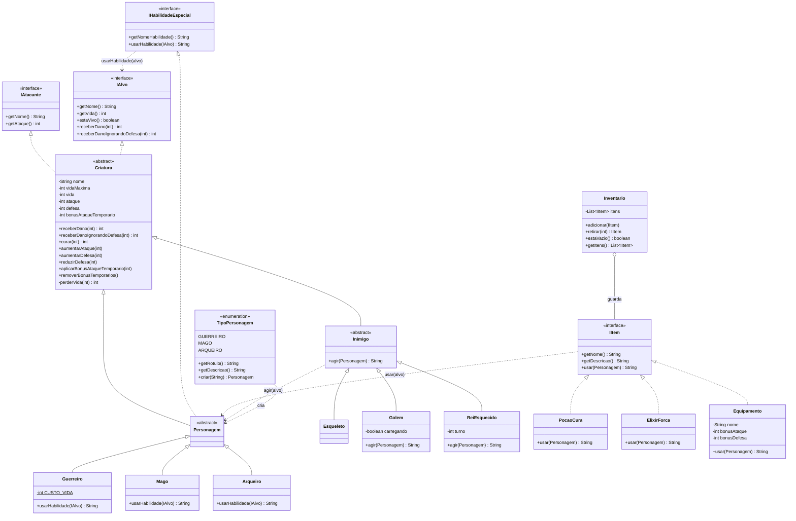
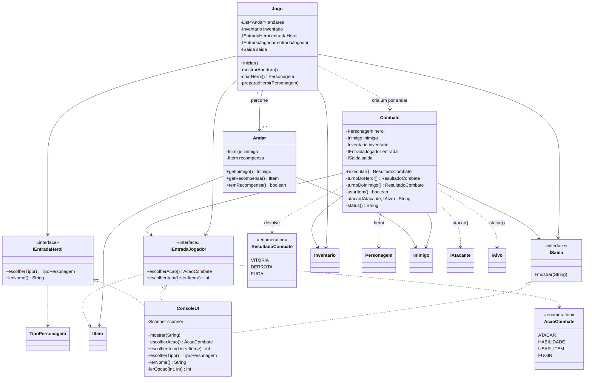

# Diagrama de Classes — A Torre do Rei Esquecido

Diagramas em Mermaid (renderizados automaticamente pelo GitHub). Para facilitar a leitura, o sistema foi dividido em dois diagramas:

1. **Modelo**: criaturas (personagens e inimigos) e itens.
2. **Fluxo**: jogo, combate e interface de console.

Também há versões em imagem: [`img/diagrama-modelo.png`](img/diagrama-modelo.png) e [`img/diagrama-fluxo.png`](img/diagrama-fluxo.png).

Legenda: seta com triângulo e linha cheia = herança; triângulo com linha tracejada = implementa interface; seta simples = associação (o objeto guarda uma referência); seta tracejada = dependência (usa ou cria); losango vazio = agregação.
Getters triviais foram omitidos para não poluir o desenho. A classe `Main` (ponto de entrada, que monta e injeta os objetos) também foi omitida.

## 1. Modelo: criaturas e itens

## 2. Fluxo: jogo, combate e interface de console

As classes `Personagem`, `Inimigo`, `Inventario`, `IItem`, `IAtacante`, `IAlvo` e `TipoPersonagem` aparecem sem detalhes neste segundo diagrama porque já foram detalhadas no primeiro.
